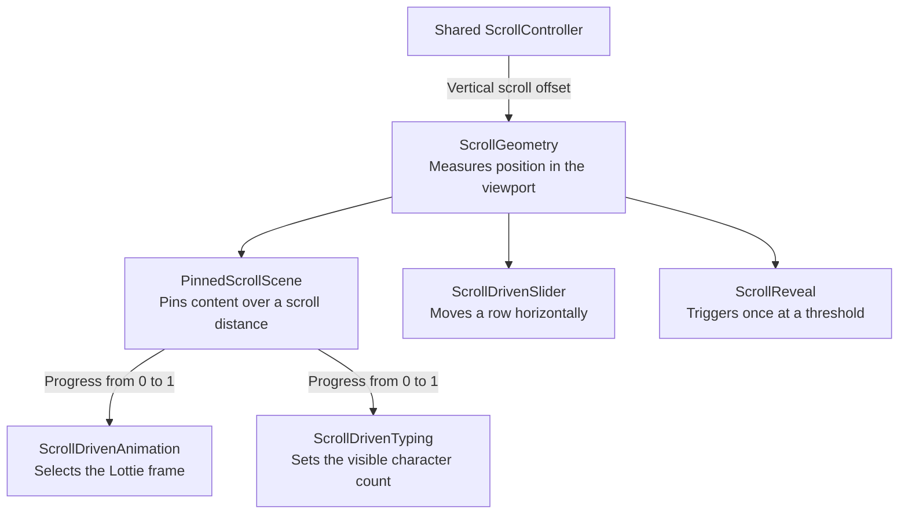

# Alex Maglio Neyra Herrada's Portfolio

> A Flutter web portfolio for anyone exploring my projects, reviewing my experience, or considering a collaboration. Reusable Flutter widgets tie animation playback, horizontal movement, and text to the reader's scroll position.

## Table of Contents

- [Scroll-driven widgets](#scroll-driven-widgets)
- [Architecture](#architecture)
- [Requirements](#requirements)
- [Installation](#installation)
- [Testing](#testing)

## Scroll-driven widgets

| Widget | Behavior |
| --- | --- |
| [ScrollDrivenAnimation](./lib/widgets/scroll_driven/scroll_driven_animation.dart) | Pins a Lottie animation in view and maps scroll distance to its current frame. Scrolling back rewinds it. Set `pixelsPerFrame` to control playback sensitivity. |
| [ScrollDrivenSlider](./lib/widgets/scroll_driven/scroll_driven_slider.dart) | Moves a row of items horizontally as it travels through the viewport. Set `direction` to move the row left or right as the reader scrolls down. |
| [ScrollDrivenTyping](./lib/widgets/scroll_driven/scroll_driven_typing.dart) | Reveals pinned text one character at a time while reserving space for the full string. Set `pixelsPerCharacter` to control the pace. Scrolling back hides the characters in reverse order. |
| [ScrollReveal](./lib/widgets/scroll_driven/scroll_reveal.dart) | Starts a one-time fade and slide when its child crosses a viewport threshold. Once revealed, the child stays visible when the reader scrolls back. |

## Architecture

[PortfolioPage](./lib/pages/portfolio_page.dart) shares a single scroll controller across its sections. On desktop, [DesktopScrollController](./lib/widgets/scroll_driven/desktop_scroll_controller.dart) smooths mouse-wheel input and cancels momentum when the wheel changes direction. Mobile uses Flutter's standard scroll controller.



[ScrollGeometry](./lib/widgets/scroll_driven/scroll_geometry.dart) measures each widget's position relative to the viewport. [PinnedScrollScene](./lib/widgets/scroll_driven/pinned_scroll_scene.dart) uses that position to keep its child in view for a configurable scroll distance. It passes progress from 0 to 1 to its builder, so the animation and typing widgets can translate the same gesture into frames or characters.

## Requirements

- A Flutter SDK with a Dart version compatible with `^3.11.4`.
- Google Chrome for the local run command below.

## Installation

```bash
git clone https://github.com/aleax888/portfolio.git
cd portfolio
flutter pub get
flutter run -d chrome
```

## Testing

The [scroll widget tests](./test/scroll_driven/) cover reversible Lottie playback, slider positioning after a resize, text pinning after layout changes, and one-time reveals.

```bash
flutter test test/scroll_driven
```

Run `flutter test` for the full suite.
